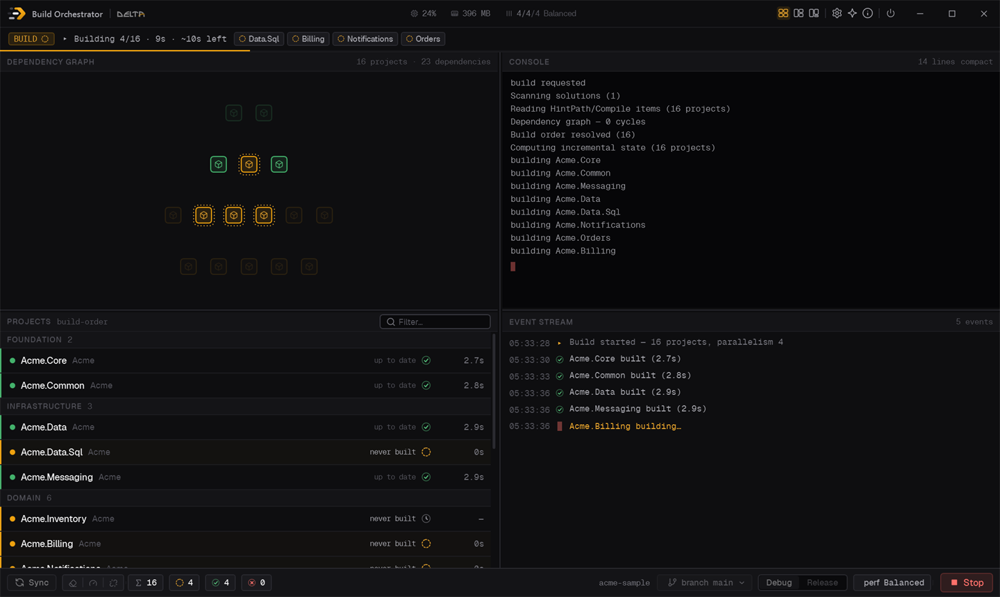
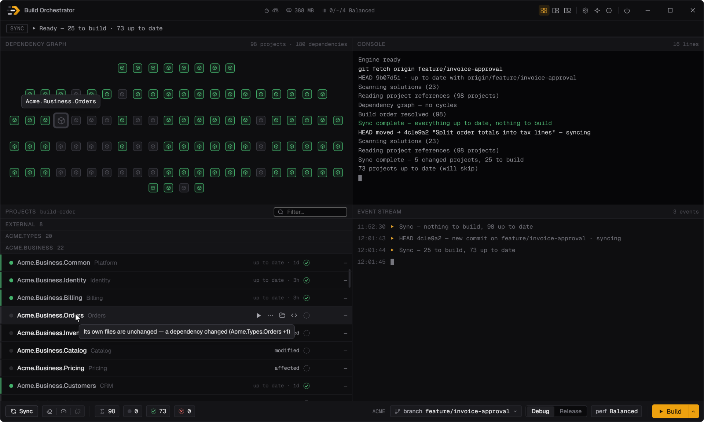
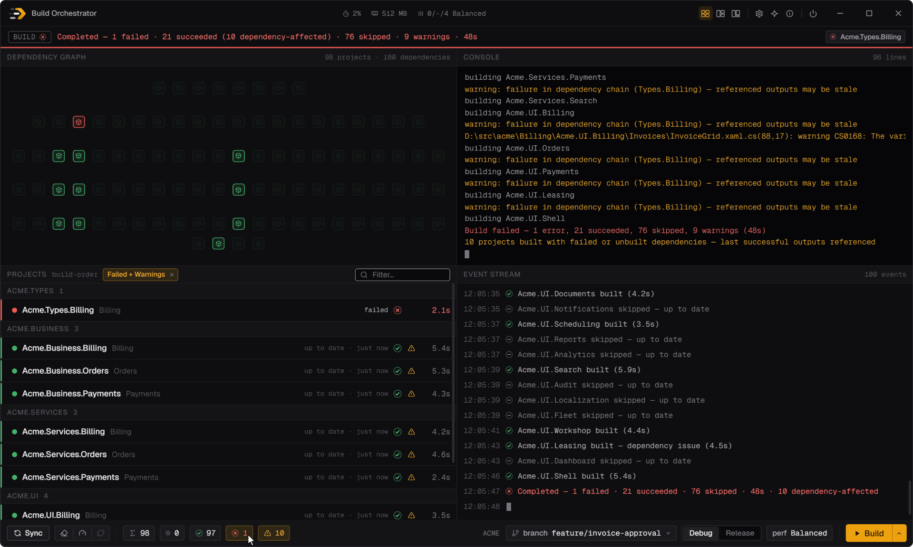
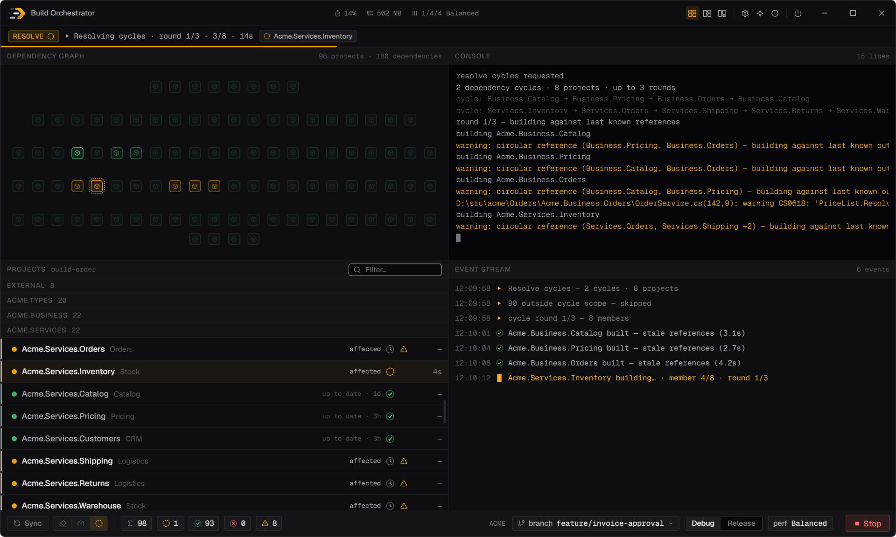
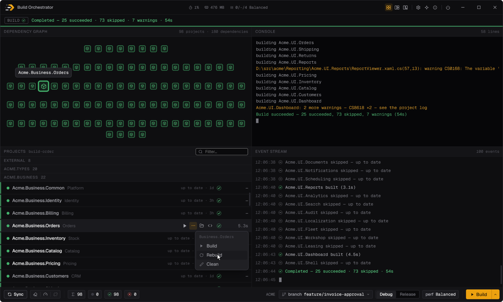
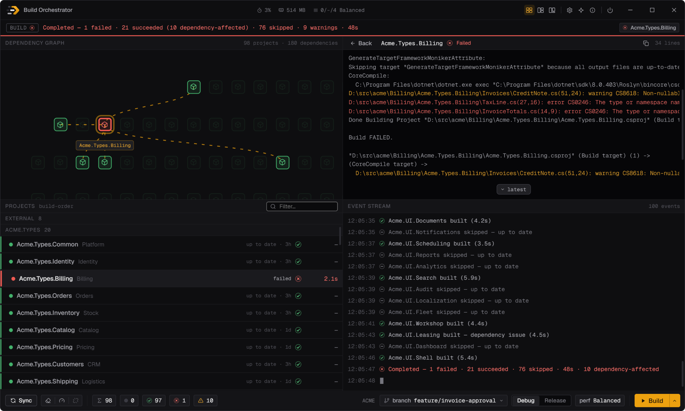
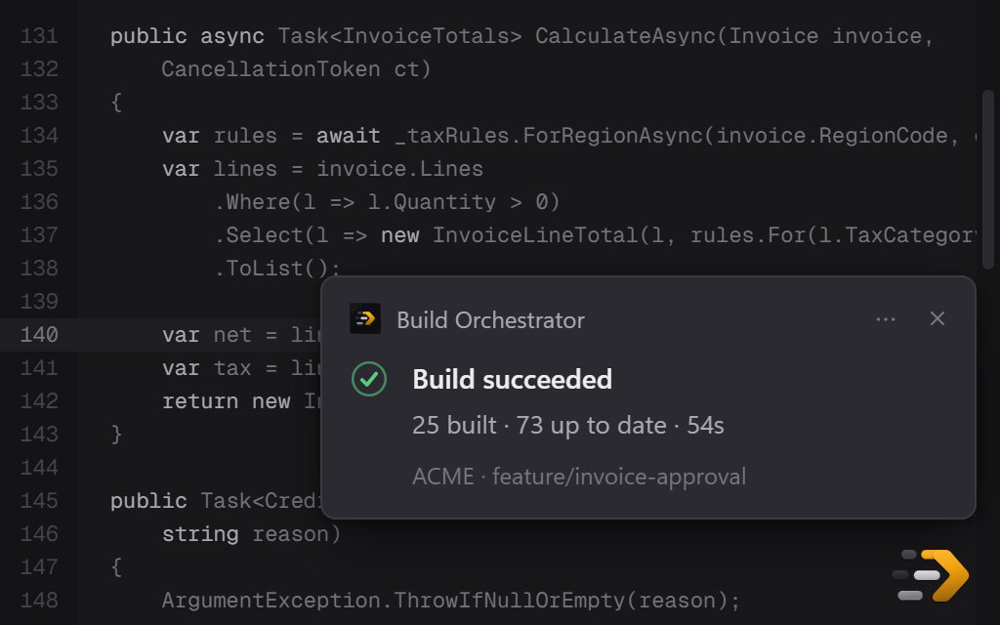

# Build Orchestrator


[English](README.md) | Türkçe

Çok projeli bir .NET çözümünü elle yapacağın gibi, ama daha hızlı ve daha güvenli derleyen bir Windows masaüstü
aracı. Bağımlılık sırasını deponun kendisinden çıkarır, yalnız değişen projeleri ve onlara bağlı olanları derler,
birbirinden bağımsız projeleri Visual Studio'nun kullandığı MSBuild ile paralel koşturur ve bütün koşuyu canlı
izletir.



## Öne çıkanlar

- **Yalnız değişeni derler.** Karar diskteki kaynak içeriğinden verilir, bağımlı projeler dahil edilir, her proje
  neden derleneceğini söyler ve Visual Studio'da yapılan derlemeler sayılır.
- **Sırayla ve paralel derler.** Sıra deponun kendisinden okunur; bağımsız projeler aynı anda, her biri kendi
  MSBuild.exe'sinde derlenir, bir hata koşuyu durdurmaz.
- **Bağımlılık döngülerini çözer.** Birbirine referans veren projeler API'leri oturana kadar turlarla derlenir.
- **Bütün çözüm tek ekranda.** Graf, liste, konsol ve olaylar koşuyu canlı izler; filtreler hatalı projeleri tek
  tıkla öne getirir.
- **Düzeltmeye tek tık.** Satır kendi projesini tek başına derler, çözümünü Visual Studio'da açar ya da Explorer'da
  gösterir.
- **Hep elinin altında.** Windows ile başlar, tepside bekler; global kısayol pencereyi açmadan derler.
- **Kendiliğinden Sync.** Commit, pull ya da branch değişikliği listeyi birkaç saniyede tazeler; sonraki Build yalnız
  farklı olanı derler.
- **Makineyi kullanılır tutar.** Perf profilleri derlemenin makineden ne kadar alacağını belirler, title bar aracın o
  anki maliyetini gösterir.
- **Tasarımı gereği güvenli.** Arkada MSBuild süreci kalmaz, git'e davetsiz yazılmaz, çıktı tam VS'nin koyduğu
  yerdedir, durdurulan koşu yarım projeyi derlenmiş saymaz.

Bütün özellikler ve nasıl çalıştıkları: [FEATURES.tr.md](docs/FEATURES.tr.md). Her birinin iş gününde neyi
değiştirdiği: [WHY.tr.md](docs/WHY.tr.md).

## Ekran görüntüleri

| Derlemeden önce: her proje neden derlenecek | Sonra: hata ve ona karşı derlenen projeler |
|---|---|
|  |  |
| **Resolve cycles: döngü oturana kadar turlar** | **Satır eylemleri: tek projeyi derle, yeniden derle, temizle** |
|  |  |
| **Hatalı proje: logu ve graftaki bağlantıları** | **Visual Studio'dan derleme: sonuç bildirim olarak gelir** |
|  |  |

## Hızlı başlangıç

1. **Gereksinimlere bak.** Windows, MSBuild bileşeniyle Visual Studio 2022 ya da Build Tools ve `PATH`'te git.
   .NET 10 Desktop Runtime eksikse kurulumcu ekler.
2. **Kur.** [Kurulumcuyu](https://github.com/sdemir60/app_build_orchestrator/releases/latest/download/BuildOrchestrator.App-win-Setup.exe)
   indir. Yönetici hakkı istemeden mevcut kullanıcıya kurulur ve kendini güncel tutar. Henüz kod imzası olmadığı
   için SmartScreen bir kez sorabilir: **More info → Run anyway** seç.
3. **Deponu göster.** İlk açılışta Settings'i aç, depo kökünü gir ve **Save and sync**'e bas, ardından **Build**'e
   (F5) bas.

Adım adım anlatım, her ekran ve her kısayol [Kullanım kılavuzu](docs/USER-GUIDE.md)'ndadır (İngilizce).

## Geliştiriciler için

```powershell
dotnet build BuildOrchestrator.slnx
dotnet test  tests/BuildOrchestrator.Tests/BuildOrchestrator.Tests.csproj --filter "Category!=Acceptance"
dotnet run   --project src/BuildOrchestrator.App/BuildOrchestrator.App.csproj
```

Derlemek için `global.json`'un belirttiği .NET 10 SDK bandı gerekir. Önce uygulamanın çalışan kopyasını kapat,
çünkü motoru kendi dosyalarını kilitli tutar. Testler, CI, paketleme ve sürüm çıkarma
[ARCHITECTURE.md § Testing](ARCHITECTURE.md#17-testing) ve
[§ Build, run, package, release](ARCHITECTURE.md#18-build-run-package-release) bölümlerinde anlatılır (İngilizce);
bu deponun çalışma kuralları [CLAUDE.md](CLAUDE.md)'dedir.

## Dokümanlar

| Doküman | İçinde ne var |
|---|---|
| [FEATURES.tr.md](docs/FEATURES.tr.md) | Bütün özellikler, en önemliden başlayarak, nasıl çalıştıklarıyla |
| [WHY.tr.md](docs/WHY.tr.md) | Her özelliğin elle ya da script'le derlemeye göre neyi değiştirdiği |
| [Kullanım kılavuzu](docs/USER-GUIDE.md) | Kurulum ve kullanım, ekran ekran, kısayollar, güncelleme, bilinen sınırlar (İngilizce) |
| [ARCHITECTURE.md](ARCHITECTURE.md) | Teknik referans: süreçler, IPC, artımlı karar, arayüz, tasarım sistemi, kod haritası (İngilizce) |
| [CHANGELOG.md](CHANGELOG.md) | Sürüm notları; uygulamadaki What's new'da da görünür (İngilizce) |

FEATURES, WHY ve bu sayfanın Türkçesi vardır; kullanım kılavuzu ve teknik referans yalnız İngilizcedir.

## Lisans

Proje **MIT Lisansı** ile lisanslanmıştır — bkz. [`LICENSE`](LICENSE).

Dahil edilip yeniden dağıtılan tek üçüncü taraf lisans *metni* **Geist** ve **Geist Mono** fontlarınındır;
**SIL Open Font License 1.1** ile lisanslıdır: `src/BuildOrchestrator.App/Assets/GEIST-LICENSE.txt`, yayın
çıktısına `Assets\GEIST-LICENSE.txt` olarak kopyalanır.
